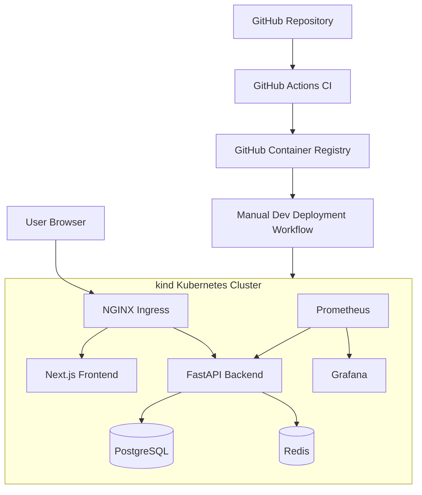

# RideFlow: DevOps Assessment

RideFlow is a sample ride-management application used to demonstrate application delivery and platform engineering practices. The project includes a FastAPI backend, a Next.js frontend, PostgreSQL, Redis, containerized builds, Kubernetes deployment, CI/CD automation, monitoring, and AWS infrastructure definitions using Terraform.

The implementation demonstrates a locally deployed and tested Kubernetes platform, alongside Terraform configurations designed for separate AWS development and production environments.

> **Deployment scope:** The application, containers, Kubernetes workloads, CI/CD workflow, and monitoring stack were implemented and tested locally using WSL2 and kind. AWS infrastructure was defined and validated with Terraform, but was not provisioned. No AWS deployment or live AWS cost measurements are claimed.

## Architecture



### Main components
| Component | Technology |
|---|---|
| Frontend | Next.js |
| Backend | Python, FastAPI |
| Relational database | PostgreSQL |
| Cache | Redis |
| Containers | Docker, Docker Compose |
| Local Kubernetes | kind |
| Ingress | NGINX Ingress Controller |
| Infrastructure as Code | Terraform, AWS modules |
| CI/CD | GitHub Actions |
| Container registry | GitHub Container Registry (GHCR) |
| Monitoring | Prometheus, Grafana, Alertmanager |
| Application metrics | Prometheus FastAPI Instrumentator |


## Repository structure

```text
.
├── backend/
├── frontend/
├── compose/
│   └── docker-compose.yml
├── docker/
├── kind/
├── kubernetes/
├── terraform/
│   ├── modules/
│   └── environments/
│       ├── dev/
│       └── prod/
├── monitoring/
├── backups/
├── .github/workflows/
└── docs/
```

## Prerequisites

For the local workflow:
- Windows with WSL2 and Ubuntu, or a compatible Linux environment
- Docker Engine
- Docker Compose plugin
- kubectl
- kind
- Helm
- Git
- Python and Node.js for optional application-level development
Terraform is required for validating the AWS infrastructure definitions.

Versions and installation details may vary by operating system. The commands below assume the repository is available in a Linux shell.
## Run locally with Docker Compose

Build and start the application stack:
docker compose -f compose/docker-compose.yml up --build -d


Inspect running services:
docker compose -f compose/docker-compose.yml ps


Inspect service logs:
docker compose -f compose/docker-compose.yml logs -f


Stop the stack:
docker compose -f compose/docker-compose.yml down


To remove Compose-managed volumes as well:
docker compose -f compose/docker-compose.yml down -v


The -v option deletes local database and cache volumes. Use it only when the local data can be discarded.

Use the service ports and health checks defined in compose/docker-compose.yml when accessing the frontend and backend.
## Kubernetes deployment on kind

The Kubernetes implementation was tested locally with a multi-node kind cluster.

The deployment includes:
- Separate development and production namespaces.
- Backend and frontend Deployments and Services.
- PostgreSQL and Redis StatefulSets with persistent volume claims.
- NGINX Ingress routing.
- Horizontal Pod Autoscaler configuration.
- Application health probes and resource settings.
- Pod security settings and environment-specific configuration.
Use the manifests and overlays in kubernetes/ for the deployment configuration. The local monitoring stack is managed separately under monitoring/.

The application is intended to be accessed through the Ingress entry point. Frontend API requests use the same-origin /api/v1 path, which the Ingress routes to the backend. Accessing the frontend Service directly bypasses this routing.

For the local development environment, the Ingress was tested through a port-forward:
kubectl port-forward -n ingress-nginx svc/<ingress-controller-service> 8081:80


The exact controller Service name can be checked with:
kubectl get svc -n ingress-nginx


Open http://localhost:8081 in the browser while the port-forward is running.
CI/CD
GitHub Actions workflows are stored in .github/workflows/.

The CI workflow includes application validation and container security checks, including:
- Backend tests.
- Frontend linting, type checking, and build validation.
- Container image build and vulnerability scanning.
- Image publishing to GitHub Container Registry.
The development deployment workflow is manually triggered and uses a self-hosted runner connected to the local kind environment.

The deployment workflow authenticates to GHCR, retrieves the required image, deploys the application, and verifies rollout status.

Required repository configuration, including any runner setup and GitHub permissions, must be configured before running the workflows. Do not commit registry credentials, application secrets, or private environment files.
Terraform and AWS infrastructure
Terraform configurations are provided under terraform/.

The reusable modules cover:
- VPC networking, public and private subnets, and NAT Gateways.
- EKS cluster and worker node infrastructure.
- RDS PostgreSQL.
- ElastiCache Redis.
- Security groups and supporting configuration.
Separate development and production environment configurations define capacity, availability, database settings, and networking choices.

Validate the Terraform configurations from the repository root:
terraform -chdir=terraform/environments/dev init -backend=false
terraform -chdir=terraform/environments/dev validate

terraform -chdir=terraform/environments/prod init -backend=false
terraform -chdir=terraform/environments/prod validate


Format validation can be performed with:
terraform fmt -check -recursive terraform/


The remote backend example contains placeholder configuration. A real deployment requires a prepared state bucket, appropriate IAM permissions, and environment-specific configuration.

Important: Terraform was formatted and validated, but terraform apply was not run. The AWS resources described by these files do not represent deployed or verified AWS infrastructure.
Monitoring and alerting
The local monitoring stack uses kube-prometheus-stack and includes:
- Prometheus for metrics collection.
- Grafana for dashboards.
- Alertmanager for alert management.
- Metrics Server for Kubernetes resource metrics.
- Node and Kubernetes component exporters.
- FastAPI application metrics exposed at /metrics.
The RideFlow application dashboard includes:
- HTTP request rate.
- HTTP 5xx error rate.
- API p95 latency.
- Backend availability.
- Requests by API handler.
Prometheus alert rules cover backend availability, elevated HTTP 5xx rates, and high API p95 latency.

The monitoring resources are under monitoring/. The dashboard and alert rules were loaded and verified locally. Actual alert notification delivery to an external receiver was not tested.
Database backup and restore
A PostgreSQL logical backup and restore exercise was completed in the local environment.

The exercise used pg_dump in custom format and restored the backup into a separate database. The restored data was checked against the original dataset.

This demonstrates a local backup and restore procedure. It does not demonstrate off-site backup storage, automated AWS backups, cross-region recovery, or a complete disaster recovery exercise.
Security and reliability
Implemented controls and documented design decisions include:
- Separate development and production configuration.
- Non-root application containers and Kubernetes security contexts.
- Dropped Linux capabilities and disabled privilege escalation.
- Readiness and liveness probes.
- Encrypted-storage and private-network design in the AWS Terraform configuration.
- Redis TLS/authentication configuration in the infrastructure design.
- Container vulnerability scanning in CI.
- Incident response runbooks and operational troubleshooting records.
The local cluster is a demonstration environment. Production controls such as managed secret delivery, etcd encryption, enforceable network policies, real TLS certificate management, and external backup retention require additional deployment-specific configuration and verification.

See the security and reliability documentation for implementation details and limitations.
Documentation
Document	Description
Architecture	System architecture and infrastructure design
Troubleshooting log	Implementation issues, investigations, and resolutions
Incident response	Operational incident scenarios and response runbooks
Security and reliability	Security controls, reliability decisions, and limitations
Cost estimate	Indicative AWS monthly cost estimate and optimization recommendations

Teardown
For the local Compose environment:
docker compose -f compose/docker-compose.yml down


For the local kind cluster, first confirm the cluster name:
kind get clusters


Then delete the relevant assessment cluster:
kind delete cluster --name <cluster-name>


Remove only the intended local resources. Do not delete shared clusters or persistent data without confirming that they are no longer needed.

No AWS resources were created for this assessment, so there are no assessment AWS resources to tear down.
Assessment scope and known limitations
The project demonstrates local application deployment, containerization, Kubernetes operations, CI/CD, monitoring, and Terraform infrastructure design.

The following items were not demonstrated as live AWS operations:
- Provisioning EKS, RDS, ElastiCache, or VPC resources in AWS.
- Deploying the application to AWS.
- AWS load balancer provisioning and integration.
- Production TLS and externally managed secrets.
- Off-site backup and full disaster recovery.
- A verified HPA scale-out event under generated load.
- External Alertmanager notification delivery.
The local kind environment also has limitations compared with a managed Kubernetes service. Some control-plane metrics endpoints are not exposed in the same way as a production cluster, and local network policy enforcement depends on the installed CNI.

These limitations are documented rather than presented as completed production capabilities.
License
This repository was prepared for a technical assessment. Refer to the repository owner for reuse and licensing permissions.
