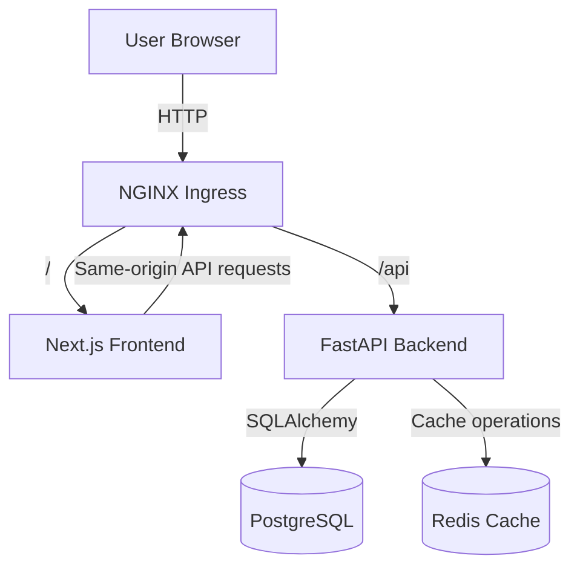

# RideFlow Architecture

## 1. Project Overview

RideFlow is a demonstration ride-management platform developed for the BCDAPPS Senior DevOps Engineer assessment.

The application provides a ride-management interface backed by a REST API, PostgreSQL persistence, and Redis caching.

The project includes:
- Next.js frontend and FastAPI backend.
- Docker multi-stage builds and Docker Compose.
- Kubernetes deployments using a local kind cluster.
- NGINX Ingress for frontend and backend routing.
- Terraform modules defining a target AWS architecture.
- GitHub Actions CI/CD with GHCR image publishing and development deployment.
- Prometheus, Grafana, and Alertmanager monitoring.
- Database backup and restore verification.

**Deployment distinction:** The application and Kubernetes platform were implemented and tested locally. AWS infrastructure is represented by Terraform code that was formatted and validated but not provisioned.

## 2. Application Architecture

### Application Components
- **Frontend:** Next.js and TypeScript, providing the ride-management interface.
- **Backend:** FastAPI and Python 3.12, providing the REST API and business logic.
- **Database:** PostgreSQL 16 for persistent ride records.
- **Cache:** Redis 7 for cache-aside operations.
- **Migrations:** Alembic for database schema versioning.
- **Containers:** Docker for application packaging.
- **Local orchestration:** Docker Compose for the four-service stack.
- **Kubernetes:** kind for the local multi-node cluster.
- **Ingress:** NGINX Ingress for HTTP path-based routing.

Component	Technology	Responsibility
Frontend	Next.js, TypeScript	Ride-management interface
Backend	FastAPI, Python 3.12	REST API and business logic
Database	PostgreSQL 16	Persistent ride records
Cache	Redis 7	Cache-aside operations
Migrations	Alembic	Database schema versioning
Containers	Docker	Application packaging
Local orchestration	Docker Compose	Four-service local stack
Kubernetes	kind	Local multi-node Kubernetes environment
Ingress	NGINX Ingress	HTTP path-based routing

Ride status transitions are validated by the backend. Completed and cancelled rides are terminal states.

Redis is used as a cache rather than the source of truth. Database-backed operations can continue when cache operations fail.
## 3. Docker and Docker Compose
The application is packaged using multi-stage Dockerfiles.
Backend image
- Python 3.12 slim Bookworm base.
- Dependencies installed in a builder stage.
- Runtime dependencies copied into a smaller runtime stage.
- Dedicated non-root application user.
- Uvicorn serves the application on port 8000.
Frontend image
- Node.js 22 Alpine.
- Dependencies installed using npm ci.
- Next.js standalone production output.
- Dedicated non-root runtime user.
- Application listens on port 3000.
The Docker Compose stack contains:
- frontend
- backend
- postgres
- redis
Services communicate over a dedicated bridge network. PostgreSQL and Redis use persistent named volumes. Health checks and service dependencies control startup readiness.

Local host bindings use loopback addresses rather than exposing all container ports to the network.
## 4. Kubernetes Architecture
The application was deployed to a local kind cluster with three Kubernetes nodes.

Separate namespaces are used for:
- rideflow-dev
- rideflow-prod
- monitoring
### Workloads and networking
- Backend and frontend Deployments.
- PostgreSQL and Redis StatefulSets.
- ClusterIP Services for internal communication.
- PersistentVolumeClaims for stateful workloads.
- NGINX Ingress for external HTTP routing.
- ConfigMaps and Kubernetes Secrets for configuration.
- Resource requests and limits.
- Liveness and readiness probes.
- HorizontalPodAutoscaler resources.
- Metrics Server for resource metrics.
The Ingress routes /api to the backend and / to the frontend. This allows browser requests to use the same application origin.

The frontend-to-backend workflow was verified through the Ingress entry point.
### Availability and security controls
Application containers run as non-root users. Pod security settings include:
- RuntimeDefault seccomp profile.
- No privilege escalation.
- Dropped Linux capabilities.
- Disabled automatic service-account token mounting where not required.
The local kind environment demonstrates Kubernetes deployment and routing. It does not establish production-grade multi-AZ availability, managed control-plane resilience, or externally accessible TLS.
## 5. Target AWS Architecture Defined by Terraform
Terraform is organized into reusable modules:
- Network.
- EKS.
- Database.
- Redis.
- Security.
Separate development and production environment configurations consume these modules.
### Target network design
The Terraform network module defines:
- A dedicated VPC.
- Two public subnets across two availability zones.
- Two private subnets across two availability zones.
- Internet Gateway.
- NAT Gateway resources.
- Separate public and private route tables.
Public subnets are intended for internet-facing entry infrastructure. Private subnets host EKS worker nodes and managed data services.
### EKS design
The EKS module defines:
- An EKS cluster.
- An IAM cluster role.
- An IAM worker-node role.
- Managed worker node groups.
- Private Kubernetes API endpoint access.
- Disabled public Kubernetes API endpoint access.
Worker nodes are placed in private subnets.
### Managed data services
The database module defines encrypted Amazon RDS PostgreSQL resources in private subnets.

The Redis module defines Amazon ElastiCache Redis resources with authentication and TLS configuration.
### Development and production differences
Setting	Development	Production
Availability zones	2	2
NAT gateways	1	1 per AZ
EKS node type	t3.medium	t3.medium
Desired worker nodes	1	2
Worker scaling range	1-2	2-3
RDS instance	db.t3.micro	db.t3.small
PostgreSQL version	16.4	16.4
RDS Multi-AZ	Disabled	Enabled
RDS allocated storage	20 GB	50 GB
RDS backup retention	7 days	14 days
RDS deletion protection	Disabled	Enabled
Redis node type	cache.t3.micro	cache.t3.small
Redis cache clusters	1	2

These values describe the Terraform configuration, not deployed AWS resources.
### Terraform state
A remote S3 backend example is provided in terraform/backend.tf.example.

The backend requires a pre-created secure state bucket and appropriate access controls. The example is not a provisioned backend.

Terraform formatting and validation were completed for both environments. No AWS apply was performed.
## 6. CI/CD Architecture
GitHub Actions provides continuous integration and development deployment workflows.
### CI workflow
The pipeline includes:
1. Repository checkout.
2. Backend dependency installation and tests.
3. Frontend linting, type checking, and build.
4. Container image builds.
5. Trivy vulnerability scanning with a critical severity gate.
6. Image publishing to GitHub Container Registry.
### Development deployment
The development deployment workflow:
- Authenticates to GHCR using GitHub Actions credentials and package read permissions.
- Retrieves the published application images.
- Loads the images into the local kind cluster.
- Applies the deployment updates.
- Verifies rollout and application health.
The development deployment uses a self-hosted runner connected to the local Kubernetes environment.

CI and development deployment workflows completed successfully after the recorded corrections.

A production deployment approval and protection workflow has not been demonstrated.
## 7. Monitoring and Alerting
The monitoring stack uses:
- Prometheus.
- Grafana.
- Alertmanager.
- Prometheus Operator and ServiceMonitor resources.
- Metrics Server for Kubernetes resource metrics.
### Application metrics
FastAPI exposes Prometheus metrics at /metrics.

The backend instrumentation provides:
- HTTP request counts.
- Request rates.
- HTTP status-code information.
- Request duration histograms.
Prometheus successfully scrapes the RideFlow backend ServiceMonitor.
### Grafana dashboard
The RideFlow dashboard includes:
1. HTTP Requests per Second.
2. HTTP 5xx Error Rate.
3. API Latency p95.
4. Backend Availability.
5. Requests by API Handler.
### Alert rules
Three RideFlow alert rules are configured:
Alert	Condition	Duration	Severity
RideFlowBackendDown	Backend target unavailable	2 minutes	Critical
RideFlowHighHTTP5xxRate	HTTP 5xx rate exceeds 5%	5 minutes	Warning
RideFlowHighAPIP95Latency	API p95 latency exceeds 0.5 seconds	5 minutes	Warning

The rules are loaded in Prometheus. Actual firing and notification delivery of these RideFlow-specific alerts have not been demonstrated.

Infrastructure monitoring is available through the installed monitoring stack. Some control-plane metrics endpoints are unavailable in the local kind environment.

Centralized log aggregation with a dedicated logging backend is not implemented.
## 8. Backup and Recovery
A PostgreSQL backup was created using pg_dump in custom format.

The backup was restored into a separate database. The original and restored databases were checked and both contained three ride records at verification time.

This demonstrates a local backup and restore workflow.

It does not demonstrate offsite backup storage, automated backup scheduling, point-in-time recovery, or a complete disaster recovery exercise.

The Terraform production RDS configuration includes a 14-day backup retention period and deletion protection.
## 9. Security Design
Implemented controls include:
- Non-root application containers.
- Kubernetes pod security hardening.
- Separate development and production namespaces.
- Private subnet placement for target AWS worker nodes and data services.
- IAM roles for EKS cluster and worker nodes.
- Database and Redis security groups.
- Redis authentication and TLS configuration in Terraform.
- Encrypted RDS storage configuration.
- Trivy container image scanning in CI.
- GitHub Actions token-based GHCR authentication.
- Environment files and local secrets excluded from Git.
- Kubernetes Secret resources for application configuration.
Production secret management through AWS Secrets Manager or an equivalent external secret provider is not demonstrated.

Production ingress TLS, centralized audit logging, and a fully enforced Kubernetes network-policy implementation remain production considerations.
## 10. Architecture Limitations and Production Improvements
The current implementation is an assessment demonstration, not a fully deployed production cloud service.

Before production use, the following work would be required:
- Provision and test the AWS environments.
- Integrate an AWS load balancer and configure DNS and TLS certificates.
- Configure secure remote Terraform state storage and access controls.
- Implement production secret management and rotation.
- Validate least-privilege IAM and Kubernetes RBAC.
- Confirm Kubernetes network-policy enforcement with a compatible network plugin.
- Add centralized application and infrastructure log aggregation.
- Configure and test alert notification receivers.
- Validate PostgreSQL backup restoration and disaster recovery procedures.
- Perform load, resilience, and failure-recovery testing.
- Configure production deployment approvals and rollback procedures.
- Review resource sizing, autoscaling, and cloud costs against actual workload requirements.
The supplied frontend is Next.js. Flutter-specific application packaging and delivery were not part of the implemented application.
## 11. Verification Summary

- **Application:** Ride creation and status workflows tested.
- **Docker Compose:** Four services verified healthy.
- **Kubernetes:** Workloads deployed to a local three-node kind cluster.
- **Ingress:** Frontend and backend routing verified.
- **Persistence:** PostgreSQL and Redis workloads deployed.
- **Backup and restore:** Local PostgreSQL backup restored and checked.
- **Terraform:** Development and production configurations formatted and validated.
- **AWS deployment:** Not provisioned.
- **CI:** Successful GitHub Actions run.
- **Development deployment:** Successful workflow and rollout.
- **GHCR:** Image authentication and retrieval verified.
- **Prometheus:** Backend metrics successfully scraped.
- **Grafana:** RideFlow dashboard displaying metrics.
- **Alert rules:** Three RideFlow rules loaded.
- **Alert notifications:** Delivery not demonstrated.

The local implementation verifies the application deployment and monitoring workflow. Terraform provides the target AWS infrastructure design, but no production cloud deployment or production availability claim is made.
