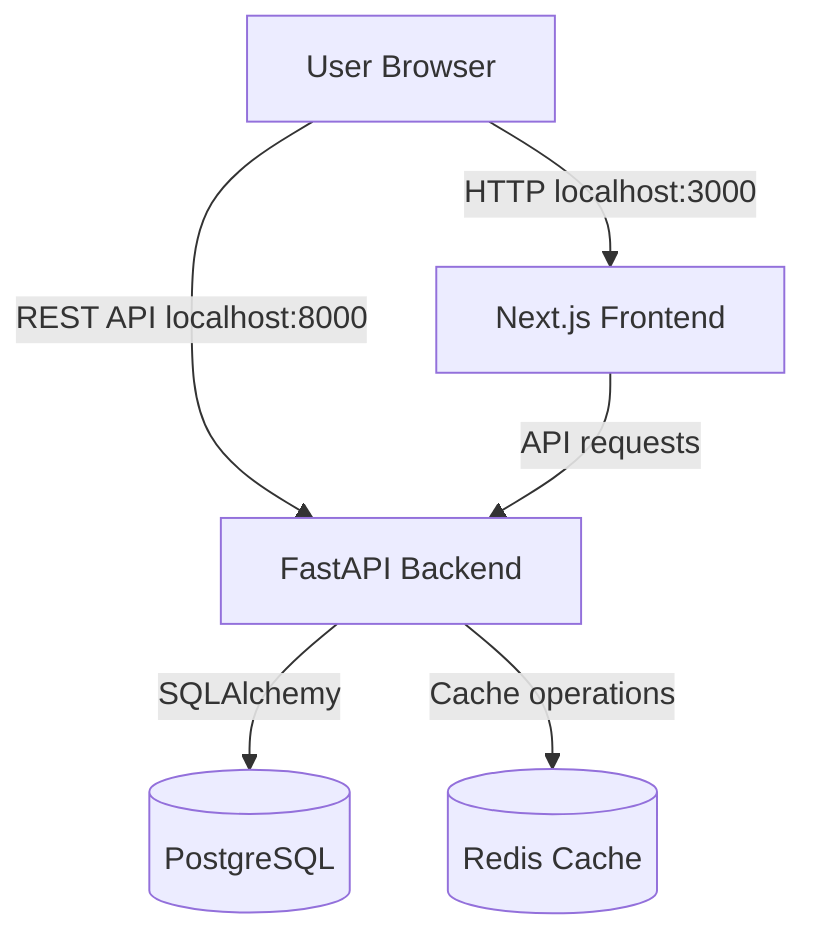

# RideFlow Architecture

## 1. Project Overview

RideFlow is a demonstration ride-management platform built for the BCDAPPS Senior DevOps Engineer assessment.

The application consists of a Next.js frontend, FastAPI backend, PostgreSQL database and Redis cache. It currently runs locally using Docker Compose.

## 2. Architecture Diagram

## 3. Application Components

| Component | Technology | Responsibility |
|---|---|---|
| Frontend | Next.js, TypeScript | Ride dashboard and user interface |
| Backend | FastAPI, Python 3.12 | REST API and business logic |
| Database | PostgreSQL 16 | Persistent ride records |
| Cache | Redis 7 | Frequently accessed application data |
| Migrations | Alembic | Database schema versioning |
| Container runtime | Docker | Application packaging |
| Orchestration | Docker Compose | Multi-container lifecycle |

## 4. Request and Data Flow

1. A user opens the Next.js application in a browser.
2. The frontend sends API requests to FastAPI.
3. The backend validates requests and executes ride-management operations.
4. PostgreSQL stores ride records and their status.
5. Redis provides cache-aside functionality with a configured TTL.
6. Cache failures do not make Redis a hard dependency for normal database-backed operations.
7. The frontend displays the API responses.

Ride status transitions are validated by the backend. Completed and cancelled rides are terminal states.

## 5. Docker Compose Architecture

The Compose deployment contains four services:

- `frontend`
- `backend`
- `postgres`
- `redis`

All services join the `rideflow` bridge network.

### Service dependencies

- Backend waits for PostgreSQL and Redis health checks.
- Frontend waits for backend health.
- Backend applies Alembic migrations before starting Uvicorn.

### Local network exposure

| Service | Container port | Host binding |
|---|---:|---|
| Frontend | 3000 | 127.0.0.1:3000 |
| Backend | 8000 | 127.0.0.1:8000 |
| PostgreSQL | 5432 | 127.0.0.1:5432 |
| Redis | 6379 | 127.0.0.1:6379 |

Host ports bind to loopback rather than all network interfaces. This is a local-development security measure, not a production ingress configuration.

The frontend uses `http://localhost:8000/api/v1` as its build-time public API base URL. Browser-side requests must use a host-reachable address rather than the internal Compose service name.

## 6. Container Design

### Backend

- Multi-stage Docker build.
- Python 3.12 slim Bookworm base image.
- Dependencies installed in a virtual environment in the builder stage.
- Application dependencies copied into the runtime stage.
- Runtime uses a dedicated non-root `app` user.
- `pip` is removed from the runtime virtual environment after dependency installation.
- Uvicorn listens on port 8000.

### Frontend

- Multi-stage Docker build using Node.js 22 Alpine.
- Dependencies installed with `npm ci`.
- Next.js production build uses standalone output.
- Runtime contains the standalone server and static assets.
- Runtime uses a dedicated non-root `nextjs` user.
- Node.js server listens on port 3000.

### Build context

The root `.dockerignore` excludes Git metadata, dependency directories, build output, Python caches, environment files, logs and Terraform state files. Example environment files are retained where applicable.

## 7. Persistence and Health Checks

PostgreSQL and Redis use named Docker volumes so their data is not tied to the lifecycle of individual containers.

Health checks are configured for all four services.

Backend health endpoints:

- `GET /api/v1/health/live`: verifies that the application process is alive.
- `GET /api/v1/health/ready`: checks PostgreSQL and Redis connectivity.

Readiness indicates whether the backend's required dependencies are available.

## 8. Security Decisions

- Local environment files are excluded from Git.
- Runtime application processes use non-root users.
- Host-published service ports bind to loopback.
- Application containers communicate over a dedicated Compose network.
- Public frontend API configuration does not contain secrets.
- Docker image vulnerability findings are reviewed and recorded separately from application functionality.

## 9. Current Scope and Limitations

This is a local Docker Compose implementation, not a production cloud deployment.

The following capabilities are not yet implemented or verified at this stage:

- Kubernetes deployment, ingress and autoscaling.
- Terraform/OpenTofu infrastructure provisioning.
- CI/CD security gates and deployment approvals.
- Centralized monitoring, dashboards and alerting.
- Production TLS termination and external DNS.
- Production-grade secret management.
- Database backup automation and tested disaster recovery.
- Multi-node production availability and load testing.

These capabilities are planned for subsequent assessment phases.

## 10. Verification Status

All four Compose services were verified running and healthy after rebuilding and recreating the backend container.

Verified responses:

- Backend liveness: HTTP 200.
- Backend readiness: HTTP 200.
- PostgreSQL readiness check: healthy.
- Redis readiness check: healthy.
- Frontend: HTTP 200.
- Browser workflow: ride creation and status updates manually tested.

This verification confirms the local application workflow. It does not establish production availability, scalability or disaster recovery.
